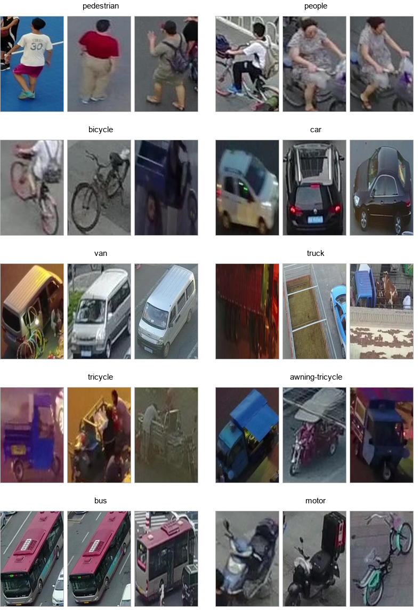

# VisDrone-ReID

This code generates a VisDrone-ReID dataset, multi-class ReID dataset, from VisDrone2019 Multi-Object Tracking 
([VisDrone-MOT](https://github.com/VisDrone/VisDrone-Dataset)) dataset, as used in 
[VisDrone-ReID: A Unified Multi-Category Object Re-Identification Benchmark](https://arxiv.org/abs/2611.20372) paper.

Train and Val MOT sequences create the ReID train set, whereas test MOT sequences create the ReID test set.
Every $N^{th}$ frame of each sequence (N = 5, 10, etc.) is used to crop the object's image patches. When evaluating the ReID
performance, each image crop of the test set is taken as query image once and is compared against all other test images
that serve as gallery. Look at the `prepare_visdrone_reid_dataset.py` and read [VisDrone-ReID](https://arxiv.org/abs/2611.20372) 
paper for more details.

The figure below shows sample crops from the VisDrone-ReID training partition across all **ten** object categories. Each 
row shows three crops of different instances from the same category.




## VisDrone-MOT Dataset

You need to download the VisDrone2019 Multi-Object Tracking ([VisDrone-MOT](https://github.com/VisDrone/VisDrone-Dataset)) 
dataset and put them in `VisDrone2019-MOT` folder. The particular [VisDrone-MOT](https://github.com/VisDrone/VisDrone-Dataset) 
dataset sequences that need to be downloaded include:

1) trainset (7.53 GB):  [BaiduYun](https://pan.baidu.com/s/16BtpKNWi0cEk8WUtfzpEHQ) | [GoogleDrive](https://drive.google.com/file/d/1-qX2d-P1Xr64ke6nTdlm33om1VxCUTSh/view?usp=sharing)
    
2) valset (1.48 GB):  [BaiduYun](https://pan.baidu.com/s/1wTWFpHw4uLXPVCp1m5fQNQ) | [GoogleDrive](https://drive.google.com/file/d/1rqnKe9IgU_crMaxRoel9_nuUsMEBBVQu/view?usp=sharing)
    
3) testset-dev (2.14 GB):  [BaiduYun](https://pan.baidu.com/s/1_gLvMxkMKb3RZjGyZv7btQ) | [GoogleDrive](https://drive.google.com/open?id=14z8Acxopj1d86-qhsF1NwS4Bv3KYa4Wu)(GT avalialbe)


You need to set to the correct `Path-To-Your-Dataset` in the `prepare_visdrone_reid_dataset.py` code to properly generate 
the required [VisDrone-ReID](https://arxiv.org/abs/2611.20372) dataset from this [VisDrone-MOT](https://github.com/VisDrone/VisDrone-Dataset) Dataset.


## Installation
Git clone this repo and install dependencies to have the same environment configuration as the one we used.

```shell
git clone https://github.com/nathanlem1/VisDrone-ReID.git
cd VisDrone-ReID/
pip install -r requirements.txt
```


## Dataset Preparation
To prepare the VisDrone-ReID dataset, run the following code on terminal. Please look into code for more information.

```shell
python prepare_visdrone_reid_dataset.py
```


## Evaluation
To evaluate a given model on the prepared dataset, run the following code on terminal. However, you first need to download 
[osnet_ibn_x1_0_imagenet.pth](https://drive.google.com/file/d/1sr90V6irlYYDd4_4ISU2iruoRG8J__6l/view?usp=sharing) 
(OSNet trained on ImageNet) or [osnet_ibn_visdrone_256x128-150.pth](https://drive.google.com/file/d/1b1PvnUAQIzycDvFn2NWYnJPjngWHqfgh/view?usp=drive_link) 
(fine-tuned on [VisDrone-ReID](https://arxiv.org/abs/2611.20372)), and put in a `pretrained` folder. Please look into code 
for more information. This gives a good example of evaluating pretrained models on this dataset; only OSNet model is 
used in this code as an example.

```shell
python evaluate_visdrone_reid_loo.py
```


## Citation

If you find this work useful in your research, please consider citing it using:

```
@misc{BilBaiJay2026,
      title={VisDrone-ReID: A Unified Multi-Category Object Re-Identification Benchmark}, 
      author={Asmau Lawal Bilbis and Nathanael L. Baisa and Amudhavel Jayavel},
      year={2026},
      eprint={2611.20372},
      archivePrefix={arXiv},
      primaryClass={cs.CV},
      url={https://arxiv.org/abs/2611.20372}, 
}
```